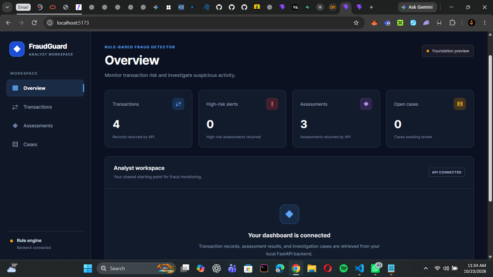
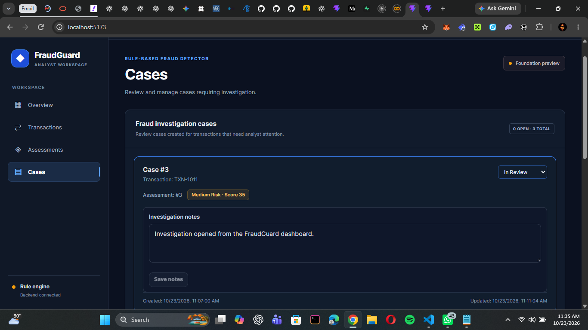

# FraudGuard — Rule-Based Fraud Detector

A rule-based fraud detection application that evaluates financial transactions, assigns explainable risk scores, and supports investigation workflows through a web dashboard.

## Project Overview

FraudGuard demonstrates how configurable detection rules, transaction data validation, persistent storage, and an analyst-facing dashboard can work together in a fraud monitoring workflow.

The application accepts transaction records, evaluates them against predefined fraud detection rules, stores assessment results, and enables analysts to create and manage investigation cases.

**Status:** Core application implemented; deployment and portfolio preparation in progress.

## Key Features

- **Transaction management:** Submit and review transaction records.
- **Rule-based detection:** Evaluate transactions using configurable detection rules.
- **Risk scoring:** Calculate a risk score and classify assessments into risk bands.
- **Explainable assessments:** Inspect individual rule outcomes and explanations.
- **Investigation management:** Create investigation cases associated with transactions and assessments.
- **Case updates:** Change investigation status and maintain case notes.
- **Persistent storage:** Store transactions, assessments, and cases in SQLite.
- **API authentication:** Protect API endpoints using API-key authentication.
- **Validation and error handling:** Validate incoming data and handle invalid or conflicting requests.
- **Automated tests:** Verify backend behavior, including transaction and persistence scenarios.
- **Dashboard:** Review transaction records, assessments, risk indicators, and investigation cases through a React interface.

## Technology Stack

| Component | Technology |
|---|---|
| Frontend | React, TypeScript, Vite |
| Backend | Python, FastAPI |
| Data validation | Pydantic |
| Database | SQLite |
| API authentication | API key |
| Testing | pytest |
| Frontend quality checks | ESLint, TypeScript compiler, Vite production build |

## Architecture

The application follows a layered architecture.

```text
Analyst
   |
   v
React + TypeScript Dashboard
   |
   v
FastAPI API Layer
   |
   +--------------------+
   |                    |
   v                    v
Transaction          Rule Engine
Validation           and Scoring
   |                    |
   +---------+----------+
             |
             v
      Persistence Layer
             |
             v
           SQLite
             |
             v
Transactions, Assessments,
and Investigation Cases
```

The frontend communicates with the backend through HTTP API endpoints. The backend validates transaction data, runs detection logic, and uses the persistence layer to retain application records.

## Fraud Detection Workflow

1. A transaction is submitted through the dashboard or API.
2. The backend validates the transaction data.
3. The rule engine evaluates the transaction against the configured detection rules.
4. The application produces a risk score, risk band, and rule-level explanations.
5. The assessment can be reviewed in the dashboard.
6. An investigation case can be created for further review.
7. The analyst can update the case status and investigation notes.
8. Stored records remain available after the application is refreshed or restarted, provided the same SQLite database file is retained.

### Detection Rules

The project specification identifies the following detection scenarios:

- **High Amount:** Transactions exceeding a configured amount threshold.
- **Unusual Amount:** Transactions that meet configured criteria for an unusual amount.
- **Velocity:** Transaction frequency or volume within a defined time window.
- **Unfamiliar Device:** Transactions involving an unfamiliar device.
- **Unusual Geography:** Potentially suspicious geographic transaction patterns.

The rule engine uses configured weights and thresholds to calculate a score capped at 100. The intended risk bands are low (0–29), medium (30–59), and high (60–100).

Risk scores are rule-based indicators, not calibrated probabilities of fraud. A flagged transaction requires appropriate review; it is not proof that fraud has occurred.

## Getting Started

### Prerequisites

Install the following before running the application:

- Python
- Node.js and npm
- Git

Use versions compatible with the project's installed dependencies.

### 1. Clone the repository

```bash
git clone <YOUR_GITHUB_REPOSITORY_URL>
cd 35-rule-based-fraud-detector
```

Replace the placeholder with the actual repository URL.

### 2. Create and activate a Python virtual environment

On Windows using Git Bash:

```bash
python -m venv .venv
source .venv/Scripts/activate
```

Install the backend dependencies using the repository's dependency file. For example, if the project uses `requirements.txt`:

```bash
pip install -r requirements.txt
```

### 3. Configure environment variables

Create a local `.env` file based on `.env.example`.

```bash
cp .env.example .env
```

Set `FRAUD_API_KEY` in `.env` to a strong, locally generated development key. Keep `.env` private and do not commit it to Git.

The API key must remain configured when running the backend. Do not place private API keys in frontend source code or publicly exposed Vite environment variables.

### 4. Start the backend

From the project root, activate the environment and load the local variables:

```bash
source .venv/Scripts/activate
set -a
source .env
set +a
uvicorn app.main:app --reload
```

The API should be available at:

- API base URL: `http://127.0.0.1:8000`
- Interactive API documentation: `http://127.0.0.1:8000/docs`
- Health endpoint: `http://127.0.0.1:8000/health`

The API documentation is useful for inspecting request schemas, authentication requirements, and available endpoints.

### 5. Start the frontend

Open a second terminal:

```bash
cd frontend
npm install
npm run dev
```

Open the local URL printed by Vite, commonly `http://localhost:5173`.

Keep the backend and frontend terminals running while using the development application.

> **Development note:** The Vite proxy is configured to forward the API key for local development. Production deployment requires a suitable secure authentication and hosting configuration; the development proxy should not be treated as a production security solution.

## API Overview

The backend exposes transaction, assessment, and investigation operations. The principal endpoints include:

| Method | Endpoint | Purpose |
|---|---|---|
| `GET` | `/health` | Check service health |
| `POST` | `/transactions` | Submit a transaction |
| `GET` | `/transactions` | Retrieve transaction records |
| `POST` | `/transactions/{transaction_id}/evaluate` | Evaluate a transaction |
| `GET` | `/assessments` | Retrieve assessment results |
| `POST` | `/cases` | Create an investigation case |
| `GET` | `/cases` | Retrieve investigation cases |
| `PATCH` | `/cases/{case_id}` | Update a case's status or notes |

API endpoints require authentication where configured by the backend. Consult `/docs` for the exact request schemas and response formats.

## Testing and Quality Checks

### Backend tests

From the repository root:

```bash
pytest -q
```

**Last recorded result:** 85 tests passed, with one dependency deprecation warning.

### Frontend lint

From the frontend directory:

```bash
npm run lint
```

### Frontend production build

```bash
npm run build
```

The frontend lint and production build checks passed during the latest recorded verification.

Test results reflect the state of the code when the checks were run. Run them again after subsequent changes.

## End-to-End Demo

A suggested demonstration sequence:

1. Open the FraudGuard dashboard.
2. Add a transaction.
3. Evaluate the transaction and inspect its risk score and triggered rules.
4. Create an investigation case for the transaction.
5. Change the case status.
6. Update the investigation notes.
7. Refresh the dashboard and verify that the records and changes persist.

Use synthetic demonstration data rather than real customer or payment information.

## Data Persistence

The application uses SQLite to persist transaction-related records. Local persistence depends on retaining and reusing the configured database file.

Before deployment, confirm that the database is stored in a durable location. Ephemeral deployment filesystems may lose locally stored SQLite data when an instance is replaced or restarted.

## Security Considerations

- Keep API credentials in server-side environment variables.
- Do not commit `.env` files or expose private credentials in the frontend.
- Keep API authentication enabled for protected endpoints.
- Use synthetic data in public demos.
- Restrict access to transaction records and investigation notes appropriately.
- Configure HTTPS and suitable production access controls before exposing the application publicly.
- Back up persistent data and test recovery procedures.
- Review logging practices to avoid recording secrets or unnecessary sensitive transaction details.

This project is an educational and portfolio demonstration. Its rules and scores should not be used as the sole basis for real financial decisions without further validation, calibration, monitoring, and appropriate human review.

## Current Limitations

- Detection depends on the configured rules and thresholds.
- Rule-based scores are not calibrated probabilities of fraud.
- Production hosting and deployment configuration still require verification.
- Production-grade identity management, authorization policies, auditing, monitoring, and backup procedures require further assessment.
- Performance and detection quality require evaluation using appropriate representative datasets before operational use.

## Roadmap

- [ ] Complete deployment and portfolio documentation.
- [ ] Capture dashboard screenshots and record a demonstration.
- [ ] Deploy the frontend and backend with secure configuration.
- [ ] Verify durable database storage in the chosen hosting environment.
- [ ] Improve audit logging and operational monitoring.
- [ ] Expand test coverage and failure-recovery scenarios.
- [ ] Evaluate detection rules against representative datasets.
- [ ] Consider more advanced analytics or machine-learning-based approaches as a separate, validated extension.

## Learning Outcomes

This project provides practical experience with:

- Rule engines and explainable decision logic.
- Data modelling and validation.
- REST API development.
- SQLite persistence and repository-based data access.
- React and TypeScript dashboard development.
- Automated testing and code-quality checks.
- API authentication and secure configuration.
- Fraud investigation workflows and risk communication.

## Screenshots

### Dashboard


### Transaction Assessment


### Investigation Case


## License

Add the project's chosen license here before distributing or reusing the code publicly.
